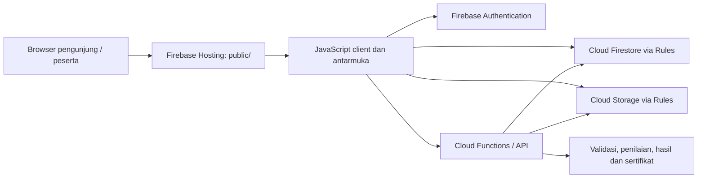

<div align="center">
  

# ESORIA CodeFest

**Platform kompetisi informatika berbasis web — registrasi, pembayaran, pelaksanaan lomba, penilaian, hasil, dan sertifikat.**

[Website produksi](https://esoria-codefest.web.app/) · [Panduan GitHub](docs/PANDUAN_GITHUB.md) · [Panduan Firebase](docs/PANDUAN_DEPLOY.md) · [Kesiapan hasil resmi](docs/KESIAPAN_HASIL_RESMI.md)

`HTML` · `CSS` · `JavaScript` · `Node.js 22` · `Firebase Authentication` · `Cloud Firestore` · `Cloud Storage` · `Cloud Functions` · `Firebase Hosting`
</div>

---

## 1. Tentang proyek

**ESORIA CodeFest** adalah aplikasi web untuk mengelola kompetisi informatika dalam satu platform. Ruang lingkup ini mencakup halaman publik, akun dan profil peserta, pendaftaran kategori dan gelombang, unggah bukti pembayaran untuk diverifikasi secara manual, pengelolaan peserta dan tim, pemberian akses bahan kompetisi, pengumpulan karya, ruang kerja administrator/juri/operasional, pengelolaan hasil, serta penerbitan dan verifikasi sertifikat sesuai aturan backend.

Repo ini berisi **kode sumber aplikasi dan konfigurasi terkait**, bukan ekspor database peserta, hasil keuangan, kredensial admin, ataupun cadangan Firebase produksi. Keberadaan sebuah modul atau skenario uji di kode tidak secara otomatis berarti alurnya telah berhasil diuji end-to-end pada lingkungan produksi. Untuk menilai kesiapan produksi, jalankan tes dan pemeriksaan operasional yang relevan.

| Informasi | Keterangan |
|:--|:--|
| Nama proyek | ESORIA CodeFest |
| Firebase Project ID | `esoria-codefest` |
| Hosting publik | <https://esoria-codefest.web.app/> |
| Jenis aplikasi | Multi-page web application (MPA), frontend HTML/CSS/JavaScript |
| Backend | Cloud Functions for Firebase (Node.js 22) |
| Basis data dan identitas | Cloud Firestore + Firebase Authentication |
| Penyimpanan | Cloud Storage for Firebase |
| Wilayah fungsi yang digunakan dalam konfigurasi | `asia-southeast2` |
| Fokus kategori | Website Programming Sprint, Cybersecurity Mini CTF, Full Stack Development Team |
| Versi paket backend | `7.1.0` pada `functions/package.json` |

### Tim pengembang

| Anggota | NIM | Area kerja dalam dokumentasi tim |
|:--|:--|:--|
| **Fikri Anwar** | 231112145 | Integrasi backend/Firebase, konfigurasi dan deployment |
| **Dafa Aditya** | 231111548 | Antarmuka dan responsivitas frontend |
| **Jordani Brema Barus** | 231112650 | Alur bisnis, pengujian dan dokumentasi |

> Pembagian area kerja pada tabel adalah pengelompokan dokumentasi kolaborasi; tim tetap perlu memastikan kesesuaiannya dengan kontribusi dan bukti kerja masing-masing sebelum dipakai untuk penilaian akademik.

## 2. Fitur dan alur utama

| Modul | Kemampuan dalam kode | Bagian terkait |
|:--|:--|:--|
| Portal publik | Informasi, aturan, kategori, tiket, persyaratan dan bantuan | `public/index.html`, `public/tickets/`, `public/legal/` |
| Akun dan autentikasi | Login, pendaftaran akun, verifikasi email, pemulihan sandi, sesi | `public/login.html`, `signup.html`, `verify-email.html`, `forgot-password.html`, `auth-*.js` |
| Profil peserta | Identitas, foto, status, notifikasi, kontrol perubahan | `public/profil.html`, `profile.js`, `profile-photo.js` |
| Registrasi | Kategori, gelombang, formulir, bukti pembayaran, status pemeriksaan | `public/form-pendaftaran.html`, `registration.js`, `functions/index.js` |
| Tim dan submission | Anggota tim, bahan lomba, unggah karya, revisi dalam periode | `public/dashboard.html`, `submission.html`, `competition-*.js` |
| Admin | Pemeriksaan registrasi, pengelolaan periode, keamanan dan operasional | `public/admin.html`, `admin.js`, `admin-security.js` |
| Juri dan operasional | Penugasan, pemeriksaan karya, tindakan operasional sesuai izin | `public/jury.html`, `operations.html`, `functions/competition.js` |
| Hasil dan sertifikat | Publikasi hasil yang memenuhi syarat serta validasi sertifikat | `public/results.html`, `verify-certificate.html`, `functions/certificate-*.js` |
| Privasi dan legal | Kebijakan, persetujuan/pilihan cookie, permintaan data | `public/legal/`, `cookie-consent.js`, `analytics-consent.js` |
| Notifikasi dan push | Pusat notifikasi dan dukungan push berbasis token | `public/notification-center.js`, `push-notifications.js`, `functions/index.js` |

**Alur tingkat tinggi:** pengunjung melihat kategori → masuk/membuat akun → melengkapi profil → memilih kategori dan periode → mengajukan pendaftaran serta bukti pembayaran → panitia memeriksa → peserta yang memenuhi syarat mengakses kegiatan dan mengunggah karya → juri melakukan penilaian sesuai penugasan → hasil disahkan/dipublikasikan → sertifikat dapat diperiksa keasliannya.

**Catatan penting:** validasi pembayaran dalam sistem bersifat **manual** oleh panitia. Tidak ada dasar untuk menyebut seluruh transaksi menggunakan *payment gateway* otomatis.

### Kategori kompetisi

- **Website Programming Sprint**: kategori pengembangan website individu.
- **Cybersecurity Mini CTF**: kategori tantangan keamanan bertipe CTF pada lingkungan kompetisi yang ditetapkan.
- **Full Stack Development Team**: kategori pengembangan aplikasi secara tim.

Aturan durasi, harga, kapasitas, dan periode adalah konfigurasi yang dapat berubah. Gunakan website/konfigurasi aktif sebagai sumber operasional, bukan menganggap nilai dalam dokumentasi berlaku untuk semua periode.

## 3. Arsitektur aplikasi



- **Frontend:** halaman HTML statis, CSS responsif, modul ES, tanpa kewajiban framework SPA.
- **Identitas:** Firebase Authentication untuk sesi pengguna; otorisasi tindakan sensitif juga diperiksa di backend dan/atau security rules, bukan hanya mengandalkan tampilan tombol.
- **Data:** dokumen Firestore berisi profil, pendaftaran, periode, tim, karya, penilaian, hasil, serta entitas pendukung. Struktur dan hak akses aktual harus dilihat pada `firestore.rules` dan fungsi backend.
- **File:** Cloud Storage menyimpan lampiran seperti bukti pembayaran dan submission, dengan aturan `storage.rules`.
- **Backend:** enam Cloud Functions yang diekspor dari `functions/index.js` untuk API, alur CTF, layanan publik, pembersihan berkala, dan pengiriman notifikasi.
- **Hosting:** `firebase.json` mengatur direktori `public/`, header keamanan, rewrite API, dan konfigurasi deploy.

### Enam Cloud Functions yang tercantum

| Nama ekspor | Fungsi umum |
|:--|:--|
| `esoriaApi` | Operasi API aplikasi dan proses bisnis terotorisasi |
| `esoriaCtf` | Endpoint/operasi terkait kategori CTF |
| `esoriaPublic` | Akses data publik yang diizinkan, termasuk hasil/arsip |
| `purgeExpiredPaymentProofs` | Pemeliharaan dan pembersihan bukti pembayaran kedaluwarsa |
| `purgeStaleCompetitionFiles` | Pemeliharaan berkas kompetisi yang sudah tidak berlaku |
| `sendParticipantPush` | Pemrosesan pengiriman notifikasi push peserta |

Tabel tersebut merangkum **tujuan modul**, bukan jaminan bahwa seluruh fungsi sedang aktif atau lolos pengujian produksi. Periksa Console, logs, secret, IAM, dan hasil *smoke test*.

### Koleksi penting Firestore

Koleksi yang teridentifikasi dari Rules dan implementasi meliputi `users`, `admins`, `registrations`, `registrationDrafts`, `teams`, `paymentProofs`, `proofUploadIntents`, `periods`, `periodSlots`, `submissions`, `submissionRevisions`, `juryAssignments`, `juryGrades`, `results`, `resultDrafts`, `certificates`, `certificateEntitlements`, `competitionConfigs`, `profileEditRequests`, `auditLogs`, dan sejumlah koleksi internal. **Tidak semua koleksi boleh dibaca langsung dari browser**; beberapa sepenuhnya dibatasi oleh security rules.

## 4. Struktur repository

```text
ESORIA-CodeFest/
├── upload.cmd                   # Satu klik: commit/push source ke GitHub
├── DEPLOY_SEMUA.cmd             # Satu klik: preflight, tes, full deploy Firebase produksi
├── README.md                    # Dokumentasi utama ini
├── .gitignore                   # Proteksi secrets dan artefak yang tidak di-commit
├── .firebaserc                  # Firebase project alias (bukan kredensial)
├── firebase.json               # Hosting, Firestore, Storage, rewrites, header
├── firebase.mfa.json           # Konfigurasi alternatif terkait MFA
├── firestore.rules             # Aturan baca/tulis database
├── firestore.rules.mfa-enforced
├── firestore.indexes.json      # Indeks komposit Firestore
├── storage.rules               # Aturan akses Storage
├── storage.cors.json           # Konfigurasi CORS Storage
├── package.json                # Dev tools dan perintah npm
├── package-lock.json           # Lockfile dependency root
├── playwright.config.mjs       # Konfigurasi tes browser
├── eslint.config.mjs           # Konfigurasi lint
├── public/                     # HTML, CSS, JS, ikon, gambar, kebijakan legal
│   ├── index.html
│   ├── login.html / signup.html / profil.html
│   ├── form-pendaftaran.html / dashboard.html / submission.html
│   ├── admin.html / jury.html / operations.html / results.html
│   ├── legal/                  # Halaman kebijakan dan ketentuan
│   ├── tickets/                # Halaman kategori/tiket
│   └── assets/                 # Logo, favicon, aset situs
├── functions/                  # Cloud Functions dan bahan kompetisi
│   ├── index.js                # Enam ekspor Cloud Functions
│   ├── competition.js / domain.js
│   ├── certificate-artwork.js / certificate-preview.js
│   ├── materials/              # Paket bahan dan manifest kompetisi
│   ├── package.json / package-lock.json
│   └── .env.example            # TEMPLATE konfigurasi, bukan konfigurasi live
├── scripts/
│   ├── github-upload.ps1       # Mesin aman untuk upload.cmd
│   ├── check-project.mjs       # Validasi skrip, JSON, aset/tautan lokal
│   ├── check-release.mjs       # Pemeriksaan struktur rilis
│   ├── run-emulators.mjs       # Emulator dengan proyek demo terisolasi
│   ├── DEPLOY_FULL_FIREBASE.ps1
│   └── live/                   # Orkestrator produksi + audit read-only
├── tests/
│   ├── browser/                # Playwright: layar dan role flows
│   ├── emulator/               # Security rules dan alur integrasi emulator
│   └── *.test.cjs / *.test.mjs # Unit, regresi, UI, dan kontrak
├── docs/
│   ├── PANDUAN_GITHUB.md
│   ├── PANDUAN_DEPLOY.md
│   └── KESIAPAN_HASIL_RESMI.md
└── .github/workflows/
    └── verify-esoria.yml       # CI validasi; TIDAK deploy produksi
```

> Direktori `node_modules/`, `.git/`, laporan hasil tes, log, dan file secret tidak dimasukkan ke GitHub. Dua berkas `.env` operasional dapat tersedia pada ZIP untuk lingkungan lokal, **tetapi sengaja diabaikan oleh Git**; operator harus mengatur kembali nilainya ketika menyiapkan mesin lain.

## 5. Upload GitHub PUBLIC sekali klik — `upload.cmd`

Target publikasi source code untuk paket ini adalah **[`fikriianwarr/esoria-codefest`](https://github.com/fikriianwarr/esoria-codefest)**, branch **`main`**, dengan status **PUBLIC**, sehingga siapa pun dapat melihat repository melalui browser. Repository GitHub dan website Firebase adalah dua layanan terpisah: push kode **tidak** menjalankan deployment.

1. Instal [Git for Windows](https://git-scm.com/downloads/win) dan [GitHub CLI](https://cli.github.com/) di Windows.
2. Ekstrak seluruh ZIP ke folder baru; jangan menjalankan file langsung dari ZIP.
3. Klik dua kali **`upload.cmd`** di root proyek, lalu selesaikan login GitHub lewat browser jika diminta.
4. Skrip mengatasi kondisi `origin` belum ada, memakai repository yang sudah ada atau membuatnya, mempertahankan riwayat remote yang sudah berisi commit saat upload awal, memeriksa file yang akan dikirim, dan melakukan push normal ke `main`.
5. Apabila repo sudah private, skrip mengubahnya menjadi **public** setelah push selesai; visibilitas akhir diverifikasi lewat GitHub CLI.
6. Buka https://github.com/fikriianwarr/esoria-codefest setelah ada pesan **BERHASIL**. Simpan folder `.git/` untuk upload berikutnya.

**Keamanan:** repository public membuat kode dan riwayat yang terjangkau menjadi terbuka untuk umum. `.env` lokal, private key, backup database, dan data pribadi tidak boleh diunggah. File `.env` lokal tetap ada di ZIP untuk kebutuhan pengujian, tetapi diabaikan oleh Git sehingga tidak diunggah. Skrip menjalankan audit pola berisiko tinggi, tetapi pemeriksaan manual tetap diperlukan. Tidak ada force-push, penghapusan repo, atau deploy Firebase otomatis.

Panduan langkah demi langkah, pemulihan error, dan skenario repo lama: **[`docs/PANDUAN_GITHUB.md`](docs/PANDUAN_GITHUB.md)**.

## 6. Menjalankan proyek di komputer lokal

### Prasyarat teknis

| Komponen | Kegunaan |
|:--|:--|
| **Node.js 22.x + npm** | Runtime skrip, alat uji, Cloud Functions |
| **Git** | Versi kode dan publikasi GitHub |
| **GitHub CLI (`gh`)** | Pembuatan repo dan autentikasi upload satu klik |
| **Java JDK 17+** | Pengujian dengan Firebase Emulator Suite |
| **Windows PowerShell 5.1** | Launcher dan alur deploy Windows |
| **Google Cloud CLI + Firebase permission** | Dibutuhkan hanya untuk deploy/audit produksi yang memerlukan akses cloud |
| **Browser modern** | Meninjau frontend lokal atau website live |

Untuk mengunduh dependensi berdasarkan lockfile (setelah clone, siapkan file `functions/.env.esoria-codefest` dari template pada lingkungan lokal sebelum tes yang memeriksa flag):

```bash
npm ci --no-fund
npm ci --no-fund --prefix functions
```

Tidak ada keharusan menjalankan `npm start` karena paket ini tidak mendefinisikan skrip `start`. Halaman `public/` adalah frontend statis yang menggunakan Firebase SDK melalui modul browser; **membuka HTML langsung sebagai `file://` tidak mewakili lingkungan aplikasi yang benar**. Untuk melihat tampilan melalui server lokal, gunakan server statis atau Hosting Emulator yang disiapkan dan pertimbangkan bahwa beberapa fungsi memerlukan autentikasi dan Firebase. Jangan melakukan eksperimen akun/pembayaran terhadap produksi tanpa otorisasi.

### Pilihan pemeriksaan

```bash
# Validasi struktur, sintaks JavaScript, JSON dan referensi lokal
npm run check

# ESLint frontend/backend/tools
npm run lint

# Tes unit dan regresi yang tersedia
npm test

# Tes kontrak responsif berbasis Node
npm run test:responsive

# Audit budget CSS
npm run audit:css

# Tes integrasi dengan Firebase Emulator terisolasi (butuh JDK + dependensi)
npm run test:emulator

# Browser end-to-end (butuh browser Playwright terpasang)
npx playwright install
npm run test:browser
```

**Harap dibedakan:** `npm test` belum mencakup semua browser test atau semua simulasi lingkungan produksi. Jika dependensi, Java, kredensial, atau konfigurasi browser tidak tersedia, beri status **tidak dijalankan/terblokir**, bukan otomatis “lulus”.

### Pengujian dengan Firebase Emulator

`npm run test:emulator` memakai project demo `demo-esoria-codefest`, port emulator yang disiapkan skrip, file konfigurasi sementara, dan data fixture sementara. Tujuannya menguji aturan akses/alur tanpa mengubah database produksi. Jangan menyalin data riil pengguna ke fixture publik. Jika ada secret operator `functions/.secret.local`, skrip sengaja tidak menimpanya.

## 7. Konfigurasi dan pengamanan lingkungan

### Berkas konfigurasi

| Berkas | Aman di GitHub? | Keterangan |
|:--|:--:|:--|
| `.firebaserc` | Ya | Alias/ID project, bukan login administrator |
| `firebase.json` | Ya | Pengaturan deploy, Hosting, rewrite, header |
| `firestore.rules`, `storage.rules` | Ya | Aturan akses; harus tetap diuji |
| `public/firebase-config.js` | Ya (berisi konfigurasi klien) | API key frontend Firebase **bukan** service-account private key; pengamanan tetap bergantung pada Rules, App Check, pembatasan API key, dan konfigurasi cloud |
| `public/runtime-config.js` | Ya (konfigurasi publik) | Site key App Check dan VAPID public key tidak setara dengan server secret |
| `functions/.env.example` | Ya | Contoh saja, tidak mewakili status production |
| `functions/.env.esoria-codefest` / `.env.demo-esoria-codefest` | **Tidak** | Konfigurasi lokal per environment yang diabaikan Git |
| `functions/.secret.local`, service-account JSON, private key | **Tidak** | Secret/kredensial: hanya di mesin aman atau layanan secret |
| `node_modules/`, logs, artifacts | Tidak | Output lokal/build/test; **ZIP bahan lomba di `functions/materials/` tetap disertakan** |

**Penting:** file `.env` bukan tempat untuk menyebarkan password. Kelola secret server seperti `CTF_FLAG_PEPPER` melalui **Google Cloud Secret Manager** dan izin yang benar. Jika suatu secret telanjur masuk riwayat Git, menghapusnya dari commit terakhir saja tidak cukup: lakukan rotasi/pencabutan dan bersihkan riwayat sesuai kebijakan.

Untuk menyiapkan environment dari template pada mesin lain (contoh PowerShell):

```powershell
Copy-Item functions/.env.example functions/.env.esoria-codefest
# EDIT nilai sesuai lingkungan produksi yang sah, verifikasi sebelum deploy
```

File `.env.example` memakai nilai contoh, **jangan langsung diterapkan ke produksi tanpa memeriksa konfigurasi aktual**, khususnya pengaturan App Check dan MFA. Peluncuran `DEPLOY_SEMUA.cmd` menargetkan proyek `esoria-codefest` dan memiliki konsekuensi nyata terhadap aturan akses dan layanan yang sedang digunakan.

### Prinsip keamanan operasional

1. Gunakan prinsip **least privilege** untuk operator, administrator, dan service account.
2. Jalankan Rules/Emulator dan pemeriksaan lint sebelum perubahan produksi.
3. Jangan mengaktifkan publikasi hasil atau sertifikat hanya berdasarkan data demo, pratinjau, atau dokumen yang belum disahkan.
4. Validasi status pembayaran di backend dan tidak menyamakan screenshot transfer dengan konfirmasi bank.
5. Jangan menyatakan MFA admin wajib aktif hanya karena implementasi kode mendukung MFA; periksa flag dan status cloud nyata.
6. Sebelum repo dijadikan **public**, tinjau hak publikasi kode, aset, materi kompetisi, data sensitif, dan seluruh riwayat GitHub.
7. Jangan mengunggah backup database, berkas pendaftaran peserta, credential cloud, hasil ekspor Auth, atau data pribadi ke issue/commit.

## 8. Deploy Firebase produksi — `DEPLOY_SEMUA.cmd`

> **Peringatan:** bagian ini menyentuh layanan Firebase **produksi**. Jangan menjalankan launcher jika belum memiliki hak resmi, mengetahui project yang dituju, dan menyiapkan strategi pemulihan.

Pengunggahan GitHub dan deploy Firebase adalah dua proses **terpisah**:

| Skrip | Tujuan | Dampak |
|:--|:--|:--|
| **`upload.cmd`** | GitHub source code | Commit dan push normal ke repo **public**; **tidak** deploy Firebase |
| **`DEPLOY_SEMUA.cmd`** | Firebase `esoria-codefest` | Pemeriksaan cloud, lint/tes/emulator lalu menerbitkan Rules, Indexes, Functions, dan Hosting sesuai preflight |

Tahapan yang didokumentasikan pada skrip deploy meliputi pemeriksaan identitas cloud, dependency dan kompatibilitas Node, validasi struktur, tes regresi/emulator, pemeriksaan metadata secret, Firestore indexes, Firestore/Storage Rules, enam Functions, Hosting, dan *smoke check* layanan publik. Deploy tidak memakai `--force` atau perintah reset database secara otomatis, tetapi perubahan Rules/Functions tetap dapat memengaruhi operasi dan **tidak ada backup/rollback otomatis**.

Jalankan hanya bila benar-benar berwenang:

```bat
DEPLOY_SEMUA.cmd
```

Kondisi khusus seperti login Google/Firebase yang kedaluwarsa tetap bisa memerlukan browser; kegagalan pemeriksaan seharusnya menghentikan proses. Periksa Firebase Console dan fitur sensitif secara manual setelah deploy. **Panduan lengkap:** [`docs/PANDUAN_DEPLOY.md`](docs/PANDUAN_DEPLOY.md).

## 9. CI/CD GitHub Actions

Tersedia `.github/workflows/verify-esoria.yml` dengan pemicu `push` ke `main`, pull request, dan `workflow_dispatch`. Job `verify` memakai **Node.js 22** dan **Java 21**, menyiapkan file flag `.env` **tanpa secret** dari template untuk kebutuhan tes CI (file asli tetap tidak disimpan di Git), lalu menjalankan instalasi dependency, lint, cek struktur, audit CSS, tes unit/regresi, dan Emulator.

**Workflow saat ini hanya verifikasi.** Tidak menjalankan `firebase deploy`, tidak menambahkan secret Firebase, dan tidak memublikasikan website. Status check hijau menunjukkan *job* tersebut berhasil pada commit terkait, **bukan jaminan seluruh alur produksi lulus**.

## 10. Panduan peran, alur rilis, dan penelusuran masalah

### Akses dan peran

- **Pengunjung:** dapat melihat informasi publik dan keluaran resmi yang sudah diizinkan.
- **Peserta/anggota tim:** mengakses data dan pengajuan miliknya sesuai autentikasi dan aturan sistem.
- **Administrator/penyelenggara:** melakukan tindakan khusus setelah backend memvalidasi kewenangan.
- **Juri:** akses penilaian dibatasi penugasan dan ruang lingkupnya.
- **Operasional:** menangani proses kompetisi sesuai izin yang diberikan.

Implementasi peran di frontend tidak boleh disamakan dengan izin keamanan yang sebenarnya. `firestore.rules`, `storage.rules`, dan Cloud Functions tetap menjadi pembatas penting.

### Sebelum menandai versi rilis sebagai siap pakai

- [ ] Kode tersimpan pada commit GitHub yang benar dan tidak ada secret terunggah.
- [ ] `npm run check` dan `npm run lint` berhasil pada mesin verifikasi.
- [ ] `npm test`, `npm run test:emulator`, dan tes browser yang relevan berhasil; kegagalan/tidak dijalankan dicatat.
- [ ] Konfigurasi project, region, Auth, App Check, Rules, secret, dan indexes telah diperiksa.
- [ ] Skenario login, akun, profil, pendaftaran, verifikasi pembayaran, unggahan, penilaian, dan hasil telah diuji secara aktual.
- [ ] Statistik kunjungan dibedakan dari jumlah peserta yang sah, sesuai dasar bukti.
- [ ] Backup/rollback dan rencana pemulihan telah disiapkan terpisah untuk deploy produksi.
- [ ] Persetujuan pemilik sistem dan peninjau akademik/operasional diperoleh jika diperlukan.

### Troubleshooting ringkas

| Situasi | Penyebab yang perlu diperiksa | Penanganan |
|:--|:--|:--|
| `git` / `gh` tidak ditemukan | Aplikasi belum dipasang atau PATH belum diperbarui | Instal Git/gh, tutup-buka CMD, coba lagi |
| GitHub CLI meminta login | Belum ada kredensial, token kedaluwarsa | Selesaikan `gh auth login` melalui browser |
| Nama repository sudah digunakan | Repo tujuan telah ada dan memiliki commit | Jangan menimpa. Lihat panduan clone atau pilih nama baru |
| Push ditolak (`non-fast-forward`) | Remote memiliki commit yang belum diintegrasikan | Periksa history/branch, lakukan `git pull`/merge secara sadar di repo yang benar; jangan `--force` |
| Push ditolak izin (`403`, protected branch) | Akses GitHub tidak cukup / kebijakan repo | Periksa akun `gh auth status`, role dan branch protection |
| Perubahan tidak ikut commit | File diabaikan `.gitignore` atau tidak berubah | Jalankan `git status` dan `git check-ignore -v nama-file` |
| `npm ci` gagal | Versi Node, jaringan, dependency, lockfile | Gunakan Node 22 dan cek log error tanpa mengabaikan kegagalan |
| Emulator gagal | JDK, port, dependency, konfigurasi lokal | Pastikan Java 17+, cek port dan jalankan ulang tes |
| Website belum berubah setelah GitHub push | GitHub upload tidak memicu Firebase deploy | Deploy Firebase hanya melalui prosedur resmi dan setelah pemeriksaan |
| Firebase deploy berhenti | Kredensial/izin cloud, secret, test, index, config | Baca pesan pertama dan panduan deploy; jangan mematikan pemeriksaan keamanan |

## 11. Pemeliharaan, kolaborasi, dan dokumentasi

Untuk perubahan kode, gunakan branch terpisah bila pekerjaan berisiko, jalankan tes relevan, jelaskan perubahan di commit/pull request, kemudian verifikasi perubahan terhadap pengguna dan keamanan. Jangan menerbitkan nomor peserta, identitas pengguna, bukti pembayaran, token push, atau data internal ke repositori dan dokumentasi terbuka.

Dokumentasi lanjutan:

- [`docs/PANDUAN_GITHUB.md`](docs/PANDUAN_GITHUB.md): cara pakai upload satu klik, konfigurasi repo, akses, clone, pemulihan error.
- [`docs/PANDUAN_DEPLOY.md`](docs/PANDUAN_DEPLOY.md): full deployment Firebase produksi.
- [`docs/KESIAPAN_HASIL_RESMI.md`](docs/KESIAPAN_HASIL_RESMI.md): pemeriksaan hasil resmi dan sertifikat.
- `tests/`: spesifikasi kasus dan pemeriksaan otomatis yang bisa ditelusuri.
- `firestore.rules`, `storage.rules`: sumber aturan akses yang sebenarnya.

## 12. Status kode, batasan, dan hak cipta

Materi ini disediakan sebagai **arsip kode pengembangan ESORIA CodeFest**. Status deploy, total pengguna, keberhasilan transaksi, dan hasil tes harus diverifikasi terhadap environment dan bukti pada tanggal pemeriksaan; README tidak memberikan jaminan “100% tanpa bug” atau nilai akademik tertentu.

**Lisensi:** belum ada lisensi open source yang secara eksplisit diberikan dalam paket. **Repository ditargetkan public**, tetapi hak penggunaan/pemublikasian kode serta materi kompetisi tetap mengikuti persetujuan pemilik. Jangan menganggap kode bebas digandakan hanya karena terlihat di GitHub.

---

<div align="center">
  <strong>ESORIA CodeFest</strong><br />
  <sub>Source code GitHub dan deployment Firebase sengaja dipisahkan untuk mencegah perubahan produksi yang tidak disengaja.</sub>
</div>
